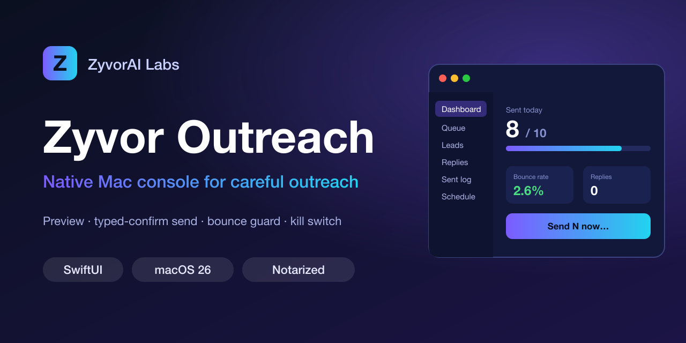

# Zyvor Outreach

### Cold email, done carefully.

A native Mac console for a handful of well-researched emails a day. You read every message before it goes, and nothing sends by surprise.

 

**[Download the 30-day trial](https://github.com/zyvorai/outreach/releases/tag/v0.11.0)** &nbsp;·&nbsp; [Website](https://zyvorai.github.io/outreach/) &nbsp;·&nbsp; [Docs](docs/README.md) &nbsp;·&nbsp; Licences: [sales@zyvor.dev](mailto:sales@zyvor.dev?subject=Zyvor%20Outreach%20licence)

`ZyvorOutreach-0.11.0.dmg` · macOS 26 or later · Developer ID signed and notarized

---

## Download (trial)

| | |
| --- | --- |
| **Get it** | [Zyvor Outreach 0.11.0](https://github.com/zyvorai/outreach/releases/tag/v0.11.0): `ZyvorOutreach-0.11.0.dmg` (the SHA-256 is in the release notes and in `ZyvorOutreach-0.11.0.dmg.sha256`) |
| **Free 30 days** | Starts on first launch. No key needed. |
| **After the trial** | A licence key from **sales@zyvor.dev**, entered under **Outreach > Licence…** |
| **Requirements** | macOS 26 or later |
| **Notarized** | Developer ID signed and notarized by Apple |

Open the DMG and drag Zyvor Outreach to Applications. Install steps: [docs/INSTALL.md](docs/INSTALL.md).

## What it is for

One person or a very small team sending a few carefully researched emails a day to published business addresses. It is deliberately not a bulk mailer.

- **You read every email first.** The queue shows the full rendered message, footer included.
- **Sending is deliberate.** A batch goes out only after you type the count to confirm.
- **It stops itself.** A bounce guard and a pause switch halt sending before a problem grows.
- **Compliance is built in.** Lawful-basis records, a suppression list, region-appropriate footers and an erasure tool.
- **Domain health at a glance.** SPF, DKIM, DMARC and blocklist checks for your sending domain.

More in [docs/FAQ.md](docs/FAQ.md) and on the [website](https://zyvorai.github.io/outreach/).

## Licence and source

Zyvor Outreach is licensed under the [Zyvor Production License v1.0](LICENSE): non-production use is free, production use needs a commercial licence. This repository holds the docs, website and downloads. The source code is private. See [docs/LICENSING.md](docs/LICENSING.md).
